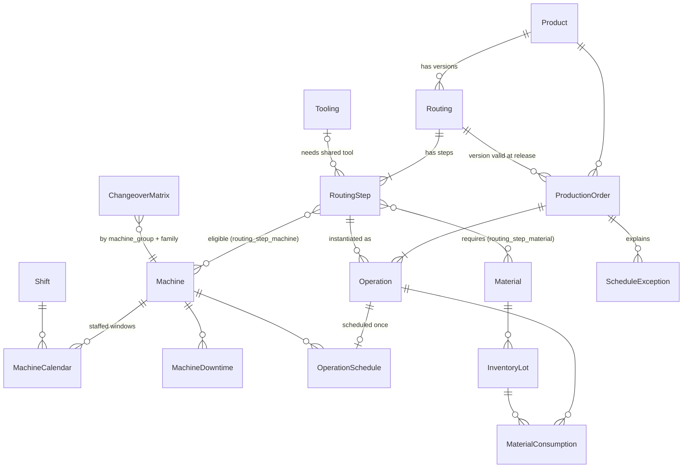

# Data dictionary

_Generated from `src/schedgen/schema.py` by `python run.py docs`; do not edit by hand._

Conventions: timestamps are plant-local ISO-8601 (`YYYY-MM-DDTHH:MM:SS`, no time zone), dates are `YYYY-MM-DD`, durations are integer minutes. Columns marked **derived** are computed from source records (`derive.finalize`) and re-checked by the validator. NULL is an empty CSV cell.

## ID / nomenclature conventions

| Entity | Pattern | Example | Notes |
|---|---|---|---|
| ProductionOrder | `PROD-2026-NNNNNN` | `PROD-2026-000001` | The brief's `PROD-` id is interpreted as the *production order* id (assumption A1) |
| Routing | `ROUTE-<sku>-VV` | `ROUTE-SKU-001-01` | `<sku>` is the Product key; `VV` is the version |
| Operation | `OP-<order-id>-SS` | `OP-PROD-2026-000001-01` | order-level instance of a routing step |
| Machine | `MACH-NNN` | `MACH-001` | |
| OperationSchedule | `SCH-2026-NNNNNN` | `SCH-2026-000001` | assigned in start-time order of the baseline plan, immutable afterwards |
| Other | `SKU-NNN`, `TOOL-NNN`, `MAT-NNN`, `LOT-NNNNNN`, `CAL-NNNNNN`, `DT-NNNNNN`, `CO-NNNNNN`, `CON-NNNNNN`, `EVT-NNNNNN`, `EXC-NNNNNN`, `GT-NNNN` | | counters are zero padded and never reused |

## Entity relationships

Cardinalities are listed per table below. The two many-to-many relationships use bridge tables (`routing_step_machine`, `routing_step_material`).

## `product` - Product

Sellable item (SKU). Master data; parent of Routing and ProductionOrder.

- **Primary key:** `sku`

| Field | Type | Required | Allowed values / pattern / range | Unit | Unique | Validation rule | Description |
|---|---|---|---|---|---|---|---|
| `sku` | str | yes | `^SKU-\d{3}$` |  | yes |  | Stock keeping unit, immutable business key. |
| `product_name` | str | yes |  |  |  |  | Descriptive name. |
| `category` | str | yes | `SHAFT`, `HOUSING`, `GEAR`, `BRACKET`, `VALVE`, `FLANGE` |  |  |  | Product category; drives routing template. |
| `changeover_family` | str | yes | `FAM-A`, `FAM-B`, `FAM-C`, `FAM-D`, `FAM-E`, `FAM-F`, `FAM-G`, `FAM-H` |  |  |  | Setup family used by the ChangeoverMatrix. |
| `uom` | str | yes | `EA` |  |  |  | Unit of measure for order quantity. |
| `standard_batch_qty` | int | yes | 1 ..  | EA |  |  | Typical batch size. |
| `status` | str | yes | `ACTIVE`, `PHASE_OUT`, `DISCONTINUED` |  |  |  | Lifecycle state. DISCONTINUED products must not be ordered. |
| `effective_from` | date | yes |  |  |  |  | First date the SKU may be ordered. |
| `effective_to` | date | no |  |  |  | effective_to >= effective_from | Last orderable date; required iff DISCONTINUED. |

## `routing` - Routing

Ordered list of steps to make a SKU. A SKU can have several dated versions.

- **Primary key:** `routing_id`
- **Foreign key:** `sku` -> `product(sku)` - Product 1:N Routing
- **Unique:** `(sku, version)`

| Field | Type | Required | Allowed values / pattern / range | Unit | Unique | Validation rule | Description |
|---|---|---|---|---|---|---|---|
| `routing_id` | str | yes | `^ROUTE-SKU-\d{3}-\d{2}$` |  | yes |  | ROUTE-<sku>-<version>. |
| `sku` | str | yes |  |  |  |  | Owning product. |
| `version` | int | yes | 1 ..  |  |  |  | Routing version number. |
| `status` | str | yes | `ACTIVE`, `RETIRED` |  |  |  | ACTIVE or RETIRED. |
| `effective_from` | date | yes |  |  |  |  | Start of validity. |
| `effective_to` | date | no |  |  |  | effective_to >= effective_from | End of validity; NULL = open ended. |

## `tooling` - Tooling

Shared fixture/tool; one physical unit that only one operation can use at a time.

- **Primary key:** `tool_id`

| Field | Type | Required | Allowed values / pattern / range | Unit | Unique | Validation rule | Description |
|---|---|---|---|---|---|---|---|
| `tool_id` | str | yes | `^TOOL-\d{3}$` |  | yes |  | Tool identifier. |
| `tool_name` | str | yes |  |  |  |  | Name. |
| `machine_group` | str | yes | `SAW`, `TURN`, `MILL`, `GRIND`, `WELD`, `HEAT`, `PAINT`, `ASSY`, `TEST` |  |  |  | Machine group the tool fits. |
| `status` | str | yes | `ACTIVE` |  |  |  | Tool status. |

## `routing_step` - Routing step (operation template)

One step of a routing; defines machine group, durations, operator and tooling requirements.

- **Primary key:** `step_id`
- **Foreign key:** `routing_id` -> `routing(routing_id)` - Routing 1:N RoutingStep
- **Foreign key:** `tool_id` -> `tooling(tool_id)` - Tooling 1:N RoutingStep (optional)
- **Unique:** `(routing_id, step_seq)`

| Field | Type | Required | Allowed values / pattern / range | Unit | Unique | Validation rule | Description |
|---|---|---|---|---|---|---|---|
| `step_id` | str | yes | `^ROUTE-SKU-\d{3}-\d{2}-S\d{2}$` |  | yes |  | <routing_id>-S<seq>. |
| `routing_id` | str | yes |  |  |  |  | Parent routing. |
| `step_seq` | int | yes | 1 ..  |  |  |  | 1-based sequence inside the routing. |
| `step_name` | str | yes |  |  |  |  | Name of the step. |
| `machine_group` | str | yes | `SAW`, `TURN`, `MILL`, `GRIND`, `WELD`, `HEAT`, `PAINT`, `ASSY`, `TEST` |  |  |  | Required machine group. |
| `cycle_min_per_unit` | float | yes | 0.01 ..  | min/unit |  |  | Nominal processing time per unit at speed_factor 1.0. |
| `fixed_min` | int | yes | 0 ..  | min |  |  | Fixed handling time per operation. |
| `operators_required` | int | yes | `1`, `2` |  |  |  | Crew needed; only shifts with crew_size >= this can run the step. |
| `tool_id` | str | no |  |  |  |  | Shared tool required (optional). |

## `machine` - Machine

Physical resource.

- **Primary key:** `machine_id`

| Field | Type | Required | Allowed values / pattern / range | Unit | Unique | Validation rule | Description |
|---|---|---|---|---|---|---|---|
| `machine_id` | str | yes | `^MACH-\d{3}$` |  | yes |  | Machine identifier. |
| `machine_name` | str | yes |  |  |  |  | Name. |
| `machine_group` | str | yes | `SAW`, `TURN`, `MILL`, `GRIND`, `WELD`, `HEAT`, `PAINT`, `ASSY`, `TEST` |  |  |  | Machine group. |
| `initial_family` | str | yes | `FAM-A`, `FAM-B`, `FAM-C`, `FAM-D`, `FAM-E`, `FAM-F`, `FAM-G`, `FAM-H` |  |  |  | Changeover family loaded at the start of the horizon. |
| `shift_pattern` | str | yes | `P1`, `P2`, `P3`, `P4` |  |  |  | P1=A Mon-Fri, P2=A+B Mon-Fri, P3=A+B Mon-Sat, P4=A+B+C Mon-Fri. |
| `status` | str | yes | `ACTIVE`, `INACTIVE` |  |  |  | Machine status. |
| `commissioned_date` | date | yes |  |  |  |  | Date machine entered service. |

## `routing_step_machine` - Step-machine eligibility (bridge)

Which machines can run a step and how fast (N:M).

- **Primary key:** `step_id, machine_id`
- **Foreign key:** `step_id` -> `routing_step(step_id)` - RoutingStep N:M Machine
- **Foreign key:** `machine_id` -> `machine(machine_id)` - RoutingStep N:M Machine

| Field | Type | Required | Allowed values / pattern / range | Unit | Unique | Validation rule | Description |
|---|---|---|---|---|---|---|---|
| `step_id` | str | yes |  |  |  |  | Routing step. |
| `machine_id` | str | yes |  |  |  |  | Eligible machine; must belong to the step's machine_group. |
| `speed_factor` | float | yes | 0.5 .. 2.0 |  |  |  | Relative speed; process_min = ceil(std_process_min / speed_factor). |

## `shift` - Shift

Labour shift definition.

- **Primary key:** `shift_id`

| Field | Type | Required | Allowed values / pattern / range | Unit | Unique | Validation rule | Description |
|---|---|---|---|---|---|---|---|
| `shift_id` | str | yes | `SHIFT-A`, `SHIFT-B`, `SHIFT-C` |  | yes |  | Shift code. |
| `shift_name` | str | yes |  |  |  |  | Name. |
| `start_time` | str | yes | `^\d{2}:\d{2}$` |  |  |  | Local start HH:MM. |
| `duration_min` | int | yes | 1 ..  | min |  |  | Length; SHIFT-C crosses midnight. |

## `machine_calendar` - MachineCalendar

Staffed working window of a machine on a date. Only staffed windows exist; absence of a row means the machine is not staffed.

- **Primary key:** `calendar_id`
- **Foreign key:** `machine_id` -> `machine(machine_id)` - Machine 1:N MachineCalendar
- **Foreign key:** `shift_id` -> `shift(shift_id)` - Shift 1:N MachineCalendar
- **Unique:** `(machine_id, calendar_date, shift_id)`

| Field | Type | Required | Allowed values / pattern / range | Unit | Unique | Validation rule | Description |
|---|---|---|---|---|---|---|---|
| `calendar_id` | str | yes | `^CAL-\d{6}$` |  | yes |  | Calendar row id. |
| `machine_id` | str | yes |  |  |  |  | Machine. |
| `calendar_date` | date | yes |  |  |  |  | Shift start date. |
| `shift_id` | str | yes |  |  |  |  | Shift. |
| `shift_start_ts` | ts | yes |  |  |  |  | Window start. |
| `shift_end_ts` | ts | yes |  |  |  | > shift_start_ts | Window end. |
| `crew_size` | int | yes | 1 .. 3 |  |  |  | Operators present. |
| `capacity_min` | int | yes |  | min |  |  | **derived** Derived: shift_end_ts - shift_start_ts. |

## `machine_downtime` - MachineDowntime

Known unavailability (maintenance, breakdown).

- **Primary key:** `downtime_id`
- **Foreign key:** `machine_id` -> `machine(machine_id)` - Machine 1:N MachineDowntime

| Field | Type | Required | Allowed values / pattern / range | Unit | Unique | Validation rule | Description |
|---|---|---|---|---|---|---|---|
| `downtime_id` | str | yes | `^DT-\d{6}$` |  | yes |  | Downtime id. |
| `machine_id` | str | yes |  |  |  |  | Machine. |
| `downtime_type` | str | yes | `PLANNED_MAINTENANCE`, `BREAKDOWN`, `CALIBRATION` |  |  |  | Type. |
| `start_ts` | ts | yes |  |  |  |  | Start. |
| `end_ts` | ts | yes |  |  |  | > start_ts | End. |
| `duration_min` | int | yes |  | min |  |  | **derived** Derived: end - start. |

## `changeover_matrix` - ChangeoverMatrix

Sequence-dependent setup time by machine group and from/to family. Asymmetric. Diagonal (same family) is a short clean-down, never zero.

- **Primary key:** `changeover_id`
- **Unique:** `(machine_group, from_family, to_family)`

| Field | Type | Required | Allowed values / pattern / range | Unit | Unique | Validation rule | Description |
|---|---|---|---|---|---|---|---|
| `changeover_id` | str | yes | `^CO-\d{6}$` |  | yes |  | Row id. |
| `machine_group` | str | yes | `SAW`, `TURN`, `MILL`, `GRIND`, `WELD`, `HEAT`, `PAINT`, `ASSY`, `TEST` |  |  |  | Machine group. |
| `from_family` | str | yes | `FAM-A`, `FAM-B`, `FAM-C`, `FAM-D`, `FAM-E`, `FAM-F`, `FAM-G`, `FAM-H` |  |  |  | Previous family. |
| `to_family` | str | yes | `FAM-A`, `FAM-B`, `FAM-C`, `FAM-D`, `FAM-E`, `FAM-F`, `FAM-G`, `FAM-H` |  |  |  | Next family. |
| `setup_min` | int | yes | 1 .. 120 | min |  |  | Required setup. |

## `material` - Material

Raw material, component or consumable.

- **Primary key:** `material_id`

| Field | Type | Required | Allowed values / pattern / range | Unit | Unique | Validation rule | Description |
|---|---|---|---|---|---|---|---|
| `material_id` | str | yes | `^MAT-\d{3}$` |  | yes |  | Material id. |
| `material_name` | str | yes |  |  |  |  | Name. |
| `category` | str | yes | `RAW`, `COMPONENT`, `CONSUMABLE` |  |  |  | Category. |
| `uom` | str | yes | `KG`, `EA`, `L` |  |  |  | Unit of measure. |
| `lead_time_days` | int | yes | 0 .. 60 | day |  |  | Nominal supplier lead time. |

## `routing_step_material` - Step-material requirement (bridge)

Material consumed per unit by a step (N:M).

- **Primary key:** `step_id, material_id`
- **Foreign key:** `step_id` -> `routing_step(step_id)` - RoutingStep N:M Material
- **Foreign key:** `material_id` -> `material(material_id)` - RoutingStep N:M Material

| Field | Type | Required | Allowed values / pattern / range | Unit | Unique | Validation rule | Description |
|---|---|---|---|---|---|---|---|
| `step_id` | str | yes |  |  |  |  | Routing step. |
| `material_id` | str | yes |  |  |  |  | Material. |
| `qty_per_unit` | float | yes | 0.001 ..  | material uom |  |  | Quantity per finished unit. |
| `scrap_pct` | float | yes | 0 .. 30 | % |  |  | Scrap allowance. |

## `inventory_lot` - InventoryLot

Received/expected lot of a material. available_ts is when stock can first be consumed.

- **Primary key:** `lot_id`
- **Foreign key:** `material_id` -> `material(material_id)` - Material 1:N InventoryLot

| Field | Type | Required | Allowed values / pattern / range | Unit | Unique | Validation rule | Description |
|---|---|---|---|---|---|---|---|
| `lot_id` | str | yes | `^LOT-\d{6}$` |  | yes |  | Lot id. |
| `material_id` | str | yes |  |  |  |  | Material. |
| `qty_received` | int | yes | 1 ..  | material uom |  |  | Lot quantity. |
| `promised_ts` | ts | yes |  |  |  |  | Supplier promised availability. |
| `available_ts` | ts | yes |  |  |  | >= promised_ts | Actual availability; >= promised_ts. |
| `delay_min` | int | yes |  | min |  |  | **derived** Derived: available_ts - promised_ts. |
| `qty_consumed` | int | yes |  |  |  |  | **derived** Derived: sum of MaterialConsumption.qty. |
| `qty_remaining` | int | yes |  |  |  |  | **derived** Derived: qty_received - qty_consumed; must be >= 0. |
| `status` | str | yes | `ON_ORDER`, `DELAYED`, `AVAILABLE` |  |  |  | **derived** Latest lifecycle state (from StatusEvent). |

## `production_order` - ProductionOrder

Demand to produce qty of a SKU by a due date.

- **Primary key:** `order_id`
- **Foreign key:** `sku` -> `product(sku)` - Product 1:N ProductionOrder
- **Foreign key:** `routing_id` -> `routing(routing_id)` - Routing 1:N ProductionOrder

| Field | Type | Required | Allowed values / pattern / range | Unit | Unique | Validation rule | Description |
|---|---|---|---|---|---|---|---|
| `order_id` | str | yes | `^PROD-2026-\d{6}$` |  | yes |  | Order id. |
| `sku` | str | yes |  |  |  |  | Product. |
| `routing_id` | str | yes |  |  |  |  | Routing version valid on release date. |
| `qty` | int | yes | 1 ..  | EA |  |  | Ordered units. |
| `order_type` | str | yes | `STANDARD`, `URGENT` |  |  |  | STANDARD or URGENT. |
| `priority` | int | yes | `1`, `2`, `3`, `4` |  |  |  | 1=urgent .. 4=low. URGENT orders are priority 1. |
| `created_ts` | ts | yes |  |  |  |  | Order entry time (<= plan run). |
| `release_ts` | ts | yes |  |  |  | >= created_ts | Earliest start on the shop floor. |
| `due_ts` | ts | yes |  |  |  | > release_ts | Customer due time. |
| `status` | str | yes | `CREATED`, `SCHEDULED`, `UNSCHEDULABLE` |  |  |  | **derived** Latest lifecycle state (from StatusEvent). |
| `total_process_min` | int | no |  | min |  |  | **derived** Derived: sum of scheduled process_min. |
| `planned_start_ts` | ts | no |  |  |  |  | **derived** Derived: min(start_ts) of its schedule rows. |
| `planned_finish_ts` | ts | no |  |  |  |  | **derived** Derived: max(end_ts) of its schedule rows. |
| `lateness_min` | int | no |  | min |  |  | **derived** Derived: max(0, planned_finish_ts - due_ts). |

## `operation` - Operation

Order-level instance of a routing step.

- **Primary key:** `op_id`
- **Foreign key:** `order_id` -> `production_order(order_id)` - ProductionOrder 1:N Operation
- **Foreign key:** `step_id` -> `routing_step(step_id)` - RoutingStep 1:N Operation
- **Foreign key:** `tool_id` -> `tooling(tool_id)` - Tooling 1:N Operation (optional)
- **Unique:** `(order_id, op_seq)`

| Field | Type | Required | Allowed values / pattern / range | Unit | Unique | Validation rule | Description |
|---|---|---|---|---|---|---|---|
| `op_id` | str | yes | `^OP-PROD-2026-\d{6}-\d{2}$` |  | yes |  | OP-<order-id>-<seq>. |
| `order_id` | str | yes |  |  |  |  | Parent order. |
| `step_id` | str | yes |  |  |  |  | Routing step it instantiates. |
| `op_seq` | int | yes | 1 ..  |  |  |  | 1-based sequence in the order; op n+1 may not start before op n ends. |
| `machine_group` | str | yes | `SAW`, `TURN`, `MILL`, `GRIND`, `WELD`, `HEAT`, `PAINT`, `ASSY`, `TEST` |  |  |  | Copied from step. |
| `operators_required` | int | yes | `1`, `2` |  |  |  | Copied from step. |
| `tool_id` | str | no |  |  |  |  | Copied from step. |
| `qty` | int | yes | 1 ..  | EA |  |  | Order quantity. |
| `std_process_min` | int | yes | 1 ..  | min |  |  | **derived** ceil(qty * cycle_min_per_unit) + fixed_min. |
| `status` | str | yes | `PLANNED`, `SCHEDULED`, `UNSCHEDULED` |  |  |  | **derived** Latest lifecycle state (from StatusEvent). |

## `operation_schedule` - OperationSchedule

Planned machine slot of an operation. Occupancy = [setup_start_ts, end_ts); process runs [start_ts, end_ts).

- **Primary key:** `schedule_id`
- **Foreign key:** `op_id` -> `operation(op_id)` - Operation 1:0..1 OperationSchedule
- **Foreign key:** `machine_id` -> `machine(machine_id)` - Machine 1:N OperationSchedule

| Field | Type | Required | Allowed values / pattern / range | Unit | Unique | Validation rule | Description |
|---|---|---|---|---|---|---|---|
| `schedule_id` | str | yes | `^SCH-2026-\d{6}$` |  | yes |  | Schedule id. |
| `op_id` | str | yes |  |  | yes |  | Scheduled operation. |
| `machine_id` | str | yes |  |  |  |  | Assigned machine; must be eligible. |
| `setup_min` | int | yes | 0 ..  | min |  |  | Changeover before the process; must be >= ChangeoverMatrix value. |
| `setup_start_ts` | ts | yes |  |  |  |  | **derived** Derived: start_ts - setup_min. |
| `start_ts` | ts | yes |  |  |  |  | Process start (material consumed here). |
| `end_ts` | ts | yes |  |  |  | > start_ts | Process end. |
| `process_min` | int | yes |  | min |  |  | **derived** Derived: ceil(std_process_min / speed_factor). |
| `status` | str | yes | `PLANNED` |  |  |  | Schedule status. |

## `material_consumption` - Material consumption

Planned issue of lot stock to an operation.

- **Primary key:** `consumption_id`
- **Foreign key:** `op_id` -> `operation(op_id)` - Operation 1:N MaterialConsumption
- **Foreign key:** `material_id` -> `material(material_id)` - Material 1:N MaterialConsumption
- **Foreign key:** `lot_id` -> `inventory_lot(lot_id)` - InventoryLot 1:N MaterialConsumption

| Field | Type | Required | Allowed values / pattern / range | Unit | Unique | Validation rule | Description |
|---|---|---|---|---|---|---|---|
| `consumption_id` | str | yes | `^CON-\d{6}$` |  | yes |  | Row id. |
| `op_id` | str | yes |  |  |  |  | Consuming operation. |
| `material_id` | str | yes |  |  |  |  | Material. |
| `lot_id` | str | yes |  |  |  |  | Lot drawn from; lot.material_id must match. |
| `qty` | int | yes | 1 ..  | material uom |  |  | Quantity drawn. |
| `consumed_ts` | ts | yes |  |  |  |  | **derived** Derived: equals the operation's start_ts. |

## `status_event` - Status event (history)

Append-only lifecycle history for orders, operations and lots.

- **Primary key:** `event_id`

| Field | Type | Required | Allowed values / pattern / range | Unit | Unique | Validation rule | Description |
|---|---|---|---|---|---|---|---|
| `event_id` | str | yes | `^EVT-\d{6}$` |  | yes |  | Event id. |
| `entity_type` | str | yes | `ORDER`, `OPERATION`, `LOT` |  |  |  | ORDER, OPERATION or LOT. |
| `entity_id` | str | yes |  |  |  |  | Id of the entity (polymorphic reference, validated per entity_type). |
| `from_state` | str | no |  |  |  |  | Previous state; NULL for the initial event. |
| `to_state` | str | yes |  |  |  |  | New state. |
| `event_ts` | ts | yes |  |  |  |  | When the transition happened/is planned. |
| `reason_code` | str | no |  |  |  |  | Why. |

## `schedule_exception` - Schedule exception

Explanation for every order that is infeasible or late.

- **Primary key:** `exception_id`
- **Foreign key:** `order_id` -> `production_order(order_id)` - ProductionOrder 1:N ScheduleException
- **Foreign key:** `op_id` -> `operation(op_id)` - Operation 1:N ScheduleException (optional)

| Field | Type | Required | Allowed values / pattern / range | Unit | Unique | Validation rule | Description |
|---|---|---|---|---|---|---|---|
| `exception_id` | str | yes | `^EXC-\d{6}$` |  | yes |  | Exception id. |
| `order_id` | str | yes |  |  |  |  | Affected order. |
| `op_id` | str | no |  |  |  |  | Affected operation (optional). |
| `exception_type` | str | yes | `MATERIAL_SHORTAGE`, `NO_CAPACITY_IN_HORIZON`, `LATE_ORDER` |  |  |  | Type. |
| `root_cause` | str | yes | `MATERIAL_SHORTAGE`, `NO_CAPACITY_IN_HORIZON`, `DUE_DATE_TOO_TIGHT`, `MATERIAL_DELAY`, `MACHINE_CAPACITY` |  |  |  | Computed root cause. |
| `lateness_min` | int | no |  | min |  |  | Lateness for LATE_ORDER. |
| `detail` | str | yes |  |  |  |  | Human readable explanation. |

## `ground_truth` - Ground truth (separate file)

Labels for injected anomalies. Never read by the generator input path or the validator.

- **Primary key:** `anomaly_id`
- **Location:** `ground_truth.csv/json` next to (not inside) `csv/`; never part of the input tables.

| Field | Type | Required | Allowed values / pattern / range | Unit | Unique | Validation rule | Description |
|---|---|---|---|---|---|---|---|
| `anomaly_id` | str | yes | `^GT-\d{4}$` |  | yes |  | GT-0001... |
| `issue_type` | str | yes | `OPERATIONS_OVERLAP`, `PRECEDENCE_VIOLATED`, `MATERIAL_CONSUMED_BEFORE_AVAILABLE`, `SCHEDULE_OUTSIDE_SHIFT_CALENDAR`, `CHANGEOVER_OMITTED` |  |  |  | Injected anomaly class. |
| `rule_id` | str | yes |  |  |  |  | Validator rule expected to fire. |
| `entity_type` | str | yes | `OPERATION_SCHEDULE`, `MATERIAL_CONSUMPTION` |  |  |  | Table of the primary affected row. |
| `entity_id` | str | yes |  |  |  |  | Primary key of the affected row. |
| `op_id` | str | yes |  |  |  |  | Affected operation. |
| `related_entity_id` | str | no |  |  |  |  | Other row involved (e.g. overlapped schedule, predecessor, lot). |
| `description` | str | yes |  |  |  |  | What was changed and why it is a violation. |
| `original_value` | str | yes |  |  |  |  | JSON of the replaced values. |
| `injected_value` | str | yes |  |  |  |  | JSON of the new values. |
